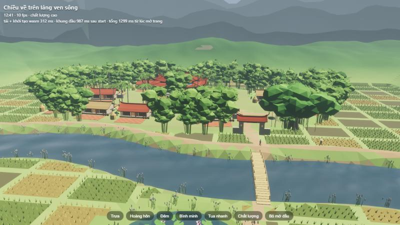
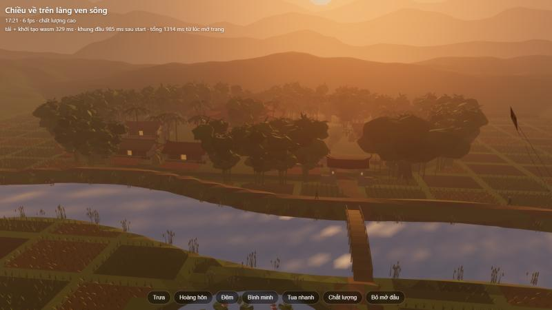
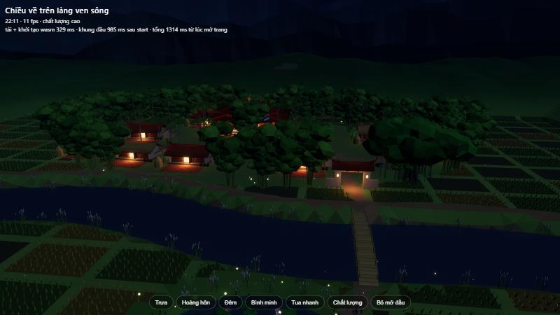
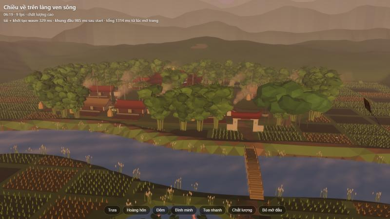

# Spike: "Chiều về trên làng ven sông"

Cảnh làng quê 3D dựng **hoàn toàn bằng code** (không tệp mô hình, không ảnh, không shader riêng), để đo xem Bevy trên web dựng được cảnh đẹp, sống động tới mức nào, với giá bao nhiêu (kích thước gói, thời gian khung đầu, CPU/GPU mỗi khung). Thiết kế: [THIET-KE.md](THIET-KE.md). Spike có thể vứt bỏ, nằm ngoài workspace chính.

| Trưa | Hoàng hôn |
|---|---|
|  |  |
| **Đêm** | **Bình minh** |
|  |  |

## Chạy

```
./build.sh fast        # lặp nhanh (~1–2 phút lần đầu, vài giây các lần sau)
./build.sh             # bản đo: opt-z + LTO + wasm-opt -Oz + brotli (~1,5–4 phút)
python -m http.server -d dist 8090
cargo run --release    # bản desktop (tiêu đề cửa sổ hiện giờ/fps; chưa thử trong spike này)
```

Điều khiển: chuột trái xoay, phải/giữa kéo, cuộn phóng; cảm ứng một ngón xoay, hai ngón chụm/kéo. Phím `1–4` đổi giờ (trưa, hoàng hôn, đêm, bình minh), `Q` chất lượng, `F` tua nhanh, `P` dừng, `Space` bỏ mở đầu. Trên web có nút tương ứng.

## Trong cảnh có gì

- **Địa hình và lớp xa:** đồng bằng có bờ ruộng; sông uốn, ao sen; ba lớp núi mờ dần trong sương; vòm trời đổi màu theo giờ, mặt trời và mặt trăng có quầng, sao, mây.
- **Làng:** đình mái cong (đầu đao, ngói, cờ hội bay), 9 nhà, cổng làng, cầu tre, giếng, cây đa (rễ phụ, tán lay), lũy tre, cau, chuối, lau sậy, sen.
- **Đồng:** ruộng lúa xanh hoặc chín, có ô ngập nước; lúa gợn theo gió (lưới thay đỉnh trên CPU).
- **Sự sống:** khói bếp lúc chiều và sáng sớm, đàn chim bay vòng, thuyền có người chèo và đèn lồng, người gánh hàng đi trên đê, trâu (một con có trẻ cưỡi), trẻ thả diều, 160 đom đóm.
- **Ánh sáng:** chu kỳ ngày đêm liên tục (12 mốc màu); đèn trong nhà và đèn lồng thắp dần khi tắt nắng, có chập chờn; HDR, tonemap ACES, bloom, sương theo khoảng cách nhuộm màu mặt trời.
- **Máy quay:** mở đầu bay 14 giây qua đình, cầu và ao rồi về toàn cảnh; bất kỳ thao tác nào cũng thoát ra ngay chỗ đang bay, không giật.

Khoảng 3.000 dòng Rust (`src/`): `world` (địa hình, sông, ruộng), `geom` (công cụ dựng lưới), `village` (công trình, cây), `life` (hoạt cảnh), `sky` (trời, giờ), `camera`.

## Kết quả đo (2026-11-26)

Máy đo: Windows 11, Intel Iris Xe, Chrome 158 (WebGL2 qua ANGLE/D3D11), canvas 1920×970, DPR 1,25. Bevy 0.20.1, wasm-bindgen 0.2.130.

| Mục | Kết quả |
|---|---|
| Gói wasm | 63,4 MB → 15,7 MB sau `wasm-opt -Oz` → **3,13 MB brotli** (+ 12 KB JS) |
| So với cảnh tối thiểu (`spikes/bevy-min`, 2,89 MB) | **+0,24 MB**: cả làng là code, không có tài nguyên |
| Tải + khởi tạo wasm | 91–108 ms (localhost) |
| Khung đầu sau `start()` | **315–354 ms** ở tab đã có cache shader; 1,8 s ở lần mở đầu trong Chrome thật (biên dịch shader) |
| FPS chất lượng cao (bloom, MSAA 4×, bóng) | **33–35 fps** |
| FPS chất lượng thấp (không bloom/MSAA/bóng, lúa đứng yên, nước 1/4 nhịp) | **~51 fps** |
| CPU mỗi khung, `First` → cuối `Render`, tab thật | cao 25–27 ms, thấp 17–19 ms |
| CPU mỗi khung, khung xem nền (GPU rảnh) | cao 12,1 ms; thấp 6,7 ms; tắt hết hoạt cảnh 4,5 ms |

Chi phí từng phần (khung xem nền, đo bằng mặt nạ `set_debug`): nước ~2,4 ms (đã giảm còn nửa nhịp), lúa gợn ~2 ms, đèn điểm và sinh vật < 1 ms mỗi loại. Phần còn lại của chênh lệch cao/thấp là bloom, MSAA và bóng.

**Chưa đo:** 4× CPU slowdown (DevTools không điều khiển được từ công cụ đo); ước lượng từ số trên là ~15–20 fps ở chất lượng cao, ~25–35 fps ở chất lượng thấp. Chưa đo trên điện thoại.

## Phát hiện

1. **Đẹp được mà không cần tài nguyên.** Lưới thủ tục, màu đỉnh, vật liệu `unlit` cho thứ phát sáng và nước cho ra cảnh có chiều sâu với +0,24 MB. Nút thắt về độ đẹp là thời gian chỉnh màu và ánh sáng, không phải dung lượng.
2. **Shader của Bevy 0.20 viết bằng WESL**, nên không chép được đoạn WGSL quen thuộc; spike làm mọi hoạt cảnh trên CPU (thay đỉnh lưới mỗi khung). Cách này chạy được nhưng tốn: riêng nước và lúa chiếm ~4 ms CPU. Sản phẩm nên viết hoạt cảnh lá, nước, lúa bằng shader đỉnh (WESL) khi cần nhiều hơn.
3. **`opt-level="z"` làm chậm mã dựng cảnh 15 lần:** khung đầu từ 0,35 s lên 5,7 s. Đặt `opt-level=3` riêng cho crate cảnh (`[profile.release.package.lang-map]`), Bevy vẫn `z`: khung đầu về 0,35 s, gói chỉ thêm 53 KB.
4. **Đo trong khung xem nhúng bị sai:** khung xem bị ẩn hoặc mất tiêu điểm thì trình duyệt hãm rAF (~1–2 lần/giây), FPS hiện ra vô nghĩa. Trên web, Bevy/winit chạy `update` ngoài callback rAF, nên bọc rAF để đo cũng sai. Cách đúng là đo trong Bevy, từ `First` tới cuối `Render` (`lib.rs`, `work_ms`), và đo FPS ở tab thật đang hiển thị.
5. **Cảnh này bị giới hạn bởi GPU trên Iris Xe** (CPU ở tab thật cao gấp đôi khung nền vì chờ GPU). Bật/tắt chất lượng cho +50% FPS. Điện thoại tầm trung nên mặc định chất lượng thấp và giảm độ phân giải render.
6. **Đơn vị ánh sáng:** Bevy dùng lux/lumen vật lý với độ phơi sáng mặc định ~1/1000, nên đèn điểm cần cường độ ×140 so với "cảm giác". Vật liệu `unlit` không chịu phơi sáng: màu > 1 cho bloom, dùng cho đèn lồng và đom đóm.
7. Các API Bevy 0.20 đã đổi so với tài liệu cũ: `shadow_maps_enabled`, `Hdr` ở `bevy::camera`, `Assets::get_mut` trả guard `AssetMut`.

## Gợi ý cho sản phẩm

- Tách gói: lõi Bevy dùng chung (~2,9 MB) và mỗi cảnh là code thủ tục nhỏ. Làng thêm chỉ 0,24 MB.
- Hoạt cảnh nhiều đỉnh (nước, cỏ, lúa) đưa lên shader WESL; giữ CPU cho logic.
- Có nút chất lượng và tự hạ chất lượng khi FPS < 30 vài giây liền.
- Biên dịch shader lần đầu (~1,5 s) nên che bằng màn "đang dựng" như spike này.
